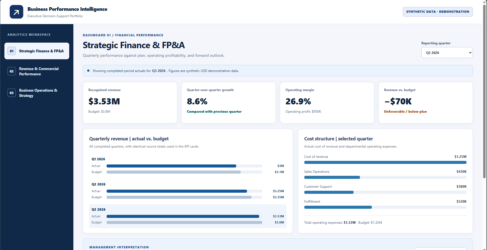
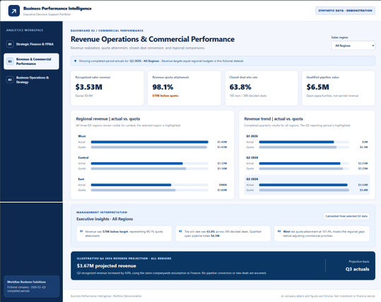
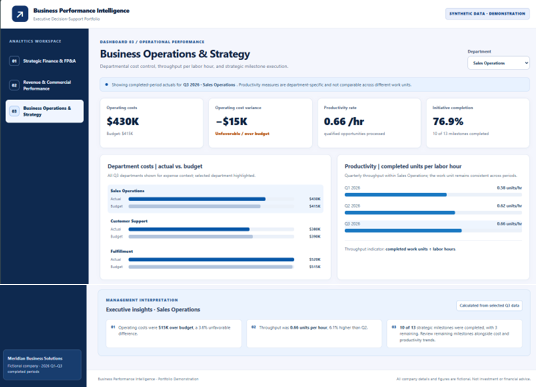

# Business Performance Intelligence

**Interactive executive decision-support portfolio | Financial Planning & Analysis • Revenue Operations • Business Operations & Strategy**

[**Explore the live dashboards**](https://cmound.github.io/Business_Performance_Intelligence/) · [View source](https://github.com/cmound/Business_Performance_Intelligence)

> **Synthetic-data disclosure:** Meridian Business Solutions is fictional. All company details, financial results, sales activity, and operational records are invented for demonstration. They do not represent any employer, client, investment, or actual business activity. This is a portfolio exercise, not a commercial finance or forecasting service.

## Business purpose

Leaders need more than a collection of metrics: they need a clear view of performance against plan, the drivers of changes, and where to direct attention. Business Performance Intelligence demonstrates how a shared set of business records can support financial, commercial, and operational decisions through three connected executive dashboards.

The portfolio emphasizes **financial analysis, performance measurement, management interpretation, and practical technology-enabled problem-solving**, not software engineering as a standalone profession.

## Three executive dashboards

| Dashboard | Questions the analysis addresses | Primary interaction |
| --- | --- | --- |
| **Strategic Finance & FP&A** | How is revenue performing against budget? What changed in operating profit and margin? Which cost areas warrant review? | Select Q1, Q2, or Q3 2026 |
| **Revenue Operations & Commercial Performance** | Are regions achieving sales targets? What is the closed-deal win rate? Where is qualified pipeline concentrated? | Select All Regions, West, Central, or East |
| **Business Operations & Strategy** | Which department is over budget? How is throughput changing? Are strategic milestones being completed? | Select Sales Operations, Customer Support, or Fulfillment |

Every dashboard includes four KPIs, two labeled visual comparisons, and dynamically calculated executive insights. The Finance dashboard also presents a clearly identified **illustrative Q4 2026 outlook**.

## Dashboard gallery

These screenshots show the three executive dashboards with the default Q3 2026 synthetic reporting data. Open the [live application](https://cmound.github.io/Business_Performance_Intelligence/) to explore the filters and their calculated KPIs, visual comparisons, and management insights.

### 1. Strategic Finance & FP&A



**Decision focus:** Budget variances, revenue growth, operating margins, expense drivers, and an assumption-based Q4 outlook.

### 2. Revenue Operations & Commercial Performance



**Decision focus:** Regional quota attainment, sales performance, closed-deal win rates, qualified pipeline, and an illustrative revenue projection.

### 3. Business Operations & Strategy



**Decision focus:** Departmental cost control, work output per labor hour, operational performance, and strategic initiative completion.

*All screenshots and measures are fictional portfolio demonstrations, not real company results.*

## Example management interpretation

The shared fictional dataset produces these Q3 2026 outcomes:

| Performance measure | Result | Management interpretation |
| --- | ---: | --- |
| Recognized revenue | $3,530,000 | $70,000 below the $3,600,000 target |
| Quarter-over-quarter growth | +8.6% | Revenue grew relative to Q2 despite missing Q3 budget |
| Operating expenses | $1,330,000 | $10,000 above the departmental operating expense budget |
| Operating profit | $950,000 | 26.9% operating margin |
| Revenue quota attainment | 98.1% | Aggregated regions finished slightly below combined quota |
| Closed-deal win rate | 63.8% | 185 wins out of 290 decided opportunities |
| Qualified pipeline value | $6,500,000 | Open pipeline is **not** recognized revenue |

These figures are calculated from the same underlying fictional records rather than entered separately into the dashboard cards.

### Decision-support examples

- **Financial control:** A revenue shortfall can coexist with positive sequential growth. Both views matter when deciding whether to revise spending or investigate commercial performance.
- **Commercial management:** Compare regional quota attainment, won/lost decisions, and qualified pipeline before deciding where sales enablement efforts deserve closer review.
- **Operational improvement:** Evaluate each department's budget variance, output per labor hour, and milestone progress together. Productivity units are department-specific and must **not** be compared as equivalent outputs across departments.

## Metric definitions and forecast assumptions

| Metric | Definition |
| --- | --- |
| Revenue budget variance | Actual recognized revenue − budgeted revenue |
| Quarter-over-quarter growth | (Current-quarter revenue ÷ previous-quarter revenue) − 1 |
| Operating profit | Revenue − cost of revenue − departmental operating expenses |
| Operating margin | Operating profit ÷ revenue |
| Revenue quota attainment | Recognized regional revenue ÷ regional target |
| Closed-deal win rate | Won deals ÷ (won deals + lost deals) |
| Operating cost variance | Budgeted departmental cost − actual departmental cost; positive is favorable |
| Productivity | Completed department-specific work units ÷ labor hours |
| Initiative completion | Completed milestones ÷ total milestones |

**Illustrative Q4 projection:** Q3 revenue × 1.04; Q3 departmental operating expenses × 1.02; Q3 cost-of-revenue ratio maintained. This produces projected revenue of **$3,671,200** and operating profit of **$1,014,600**. The projection is a simple, documented business scenario, **not** a statistical forecast or prediction of real-world results. For a selected revenue region, the same 4% assumed growth is applied to that region's Q3 revenue.

**Reporting boundaries:** Q1–Q3 2026 are synthetic *completed* periods; Q4 is illustrative. The Finance reporting quarter selector changes its selected-quarter KPIs, cost visualization, and insights. The regional and departmental dashboards display Q3 performance and trend context. Q1 quarter-over-quarter growth is unavailable because the dataset contains no Q4 2025 baseline.

## Technology and implementation

- **React + TypeScript:** Interactive dashboard state, reusable visual patterns, and typed synthetic records.
- **Vite:** Development tooling and static production build.
- **Plain CSS:** Desktop/laptop-oriented executive layout, readable typography, high contrast, and explicit positive/negative labels.
- **GitHub Actions + GitHub Pages:** Automated linting, build checks, and deployment of the static site.
- **No backend or external services:** No authentication, databases, cloud sync, external API calls, or user-data collection.

The source files are deliberately compact: `src/App.tsx` contains the interface; `src/App.css` contains dashboard styling; `src/demoData.ts` contains synthetic records; and `src/metrics.ts` contains reusable calculations and data-reconciliation checks.

## Run locally

**Requirements:** Node.js 22 (or another version supported by the installed Vite release) and npm.

```powershell
npm ci
npm run lint -- --max-warnings=0
npm run build
npm run dev
```

The local dev server displays its URL in the terminal. To preview the actual production build locally, use `npm run preview` after building.

## Validation and interpretation safeguards

- Revenue in the Finance dashboard reconciles to summed regional revenue in Revenue Operations.
- Budgeted revenue reconciles to summed regional quotas under a stated simplifying assumption.
- Departmental operating expenses reconcile to Finance operating expenses.
- Net operating profit uses revenue, cost of revenue, and department costs from the same reporting period.
- Chart bars are accompanied by numeric labels; unfavorable/favorable results are also identified in text, not color alone.
- Input records are fixed fictional demonstrations, so the app requires no data entry or ongoing synchronization.

The application also includes runtime reconciliation checks. Passing a build does not replace manual review of every dashboard and filter after deployment.

## Portfolio scope

This application is an **analytical demonstration**, not a multiuser enterprise financial platform. It intentionally omits advanced statistical forecasting, scenario editing, data ingestion, authentication, persistence, and exports. These omissions keep the portfolio focused on interpreting business performance and presenting management-relevant insights.

---

**Repository:** [cmound/Business_Performance_Intelligence](https://github.com/cmound/Business_Performance_Intelligence)  
**Deployment:** [Business Performance Intelligence on GitHub Pages](https://cmound.github.io/Business_Performance_Intelligence/)
